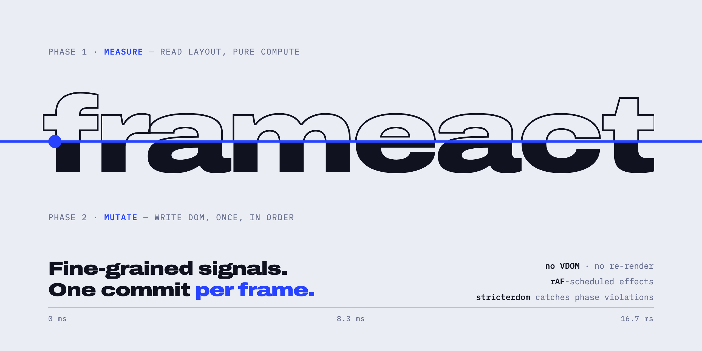

<p align="center">
  
</p>

<p align="center">
  <a href="README.md">English</a> · <a href="README.ru.md">Русский</a> · <b>简体中文</b>
</p>

# frameact

**细粒度信号（fine-grained signals）。每帧只提交一次。**

frameact 是一个面向"每一帧都很重要"的应用的响应式 UI 框架：比如拥有上千条消息历史的即时通讯应用、
在手指下实时重排的会话列表，以及在中端手机上也不能卡顿的动画。它把 **细粒度信号**（没有虚拟 DOM，组件只执行一次，
只更新绑定）与 **[teact](https://github.com/Ajaxy/teact) 的帧调度纪律** 结合起来 —— teact 正是 Telegram Web A
背后的框架：

- **每帧一次处理** —— 所有响应式工作和所有 DOM 写入都合并到同一个 `requestAnimationFrame` 中；
- **显式阶段** —— `measure → mutate → forced-reflow measure → forced-reflow mutate`，布局读取永远不会与
  DOM 写入交错（没有 layout thrashing）；
- **重动画闸门（heavy-animation gating）** —— 阻塞式动画进行期间，帧内工作会被暂存，并在动画结束后的一帧内统一释放；
  可以作用于全局，也可以只作用于某个子树；
- **stricterdom** *（计划中）* —— 开发模式下在 DOM API 层面捕获阶段违规，并指出是哪个 effect 造成的。

> **状态：早期开发。** 响应式内核（[PR #1](https://github.com/denislibs/frameact/pull/1)）与 DOM 运行时已实现：
> 面向 Solid 2.0 JSX 编译器（`@solidjs/babel-plugin@2.0.0-rc.14`）的 `frameact/dom`、`render`、
> `For`（含 `order="manual"`）、`Show`/`Switch`/`Match`/`Dynamic`/`Portal`、受控输入（`use:value` / `use:checked`）、
> `HeavyAnimationScope`、context `Provider`，以及 `frameact/vite` 插件。接下来是 store 与 stricterdom。
> 尚未发布到 npm，API 可能变化。

## 为什么

基于信号的框架（Solid、Vue、Svelte 5、Preact Signals）在微任务中刷新 effect，每个 effect 一运行就立即写 DOM。
当一个 effect 读取布局而另一个写入时，读写会交错，浏览器在同一帧内被迫一次又一次地重新计算布局。

teact 通过 **fasterdom** 为虚拟 DOM 渲染器解决了这个问题：每个 DOM 操作要么是 *测量（measurement）*，要么是
*变更（mutation）*，它们被安排到同一动画帧的不同阶段。frameact 把同样的纪律带到细粒度响应式中 —— 在这里，
一次更新只是一个绑定，而不是整个组件的重新渲染。

| | teact | Solid 1.x / 2.0 | frameact |
|---|---|---|---|
| 更新模型 | VDOM diff，组件重新渲染 | 细粒度 | 细粒度 |
| 刷新时机 | rAF，单次处理 | 微任务 | rAF，单次处理 |
| measure / mutate 阶段 | 有 | 无 | 有 |
| 重动画闸门 | 全局 | 无 | 全局 + 子树 |
| 阶段违规检查 | stricterdom | 无 | stricterdom + 定位到 effect *（计划中）* |

## 工作原理

effect 被拆成两半：被追踪的纯 **compute**，以及不被追踪、负责执行副作用的 **apply**。*阶段即调度器* ——
选择哪个入口函数，就决定了 apply 在何时运行：

```ts
import {
  createSignal, createEffect, createMeasureEffect, createMutationEffect, createIdleEffect,
} from 'frameact';

const [height, setHeight] = createSignal(0);
const [expanded, setExpanded] = createSignal(false);

// measure 阶段：读取布局
createMeasureEffect(() => expanded(), () => setHeight(panel.offsetHeight));

// 同一帧的 mutate 阶段：写入 DOM
createMutationEffect(() => height(), (h) => { spacer.style.height = `${h}px`; });

// 微任务：不涉及 DOM 的逻辑（网络、store）
createEffect(() => expanded(), (open) => analytics.track('panel', { open }));

// 浏览器空闲且没有动画时
createIdleEffect(() => expanded(), () => prefetchDetails());
```

帧调度保证：

- 一次写入弄脏了 N 个 effect → **一次** rAF，每个阶段一个任务；
- 在 measure 的 apply 中写入的信号，**在同一帧** 内到达 mutation effect；
- mutate 阶段计算过程中产生的写入（例如带 key 的列表更新其行）会进入 **同一轮处理**；
- 在 mutate 阶段被弄脏的 measure effect 会在下一帧运行（开发模式下会给出警告）；
- `frameForcedReflow` 用于少见的 "mutate → measure → mutate"（FLIP）场景，仍然在同一帧内完成。

重动画：

```ts
import { beginHeavyAnimation, createHeavyAnimationScope, provideHeavyAnimationScope } from 'frameact';

const end = beginHeavyAnimation(300, /* isBlocking */ true); // 最多 300 ms 内暂存所有帧内工作
// ……或者只作用于子树：会话列表在聊天栏滑入时仍然持续更新
const scope = createHeavyAnimationScope();
provideHeavyAnimationScope(scope);
scope.begin(300, true);
```

组件以纯 Solid 风格编写 —— 只执行一次，props 是 getter —— 并由指向 frameact 运行时的 Solid 2.0 JSX 编译器编译（`moduleName: "frameact/dom"`）：

```ts
// vite.config.ts
import frameact from 'frameact/vite';
export default { plugins: [frameact()] };
// tsconfig.json: "jsx": "preserve", "jsxImportSource": "frameact"
```

```tsx
import { createSignal } from 'frameact';
import { render } from 'frameact/dom';

function Composer() {
  const [text, setText] = createSignal('');
  return <input use:value={text} onInput={(e) => setText(e.currentTarget.value.trimStart())} />;
}
render(() => <Composer />, document.getElementById('app')!);
```

`class=` / `classList=` / 展开属性按 token 做 diff，因此命令式的 `addExtraClass` 在更新后依然保留；字符串形式的 `style=`
会写入 `cssText`，与 `setExtraStyles` 不兼容。受控输入使用 `use:value` / `use:checked` —— 响应式的 `value=` 会被当作属性直接写入，
Vite 插件会在开发模式下给出警告。如需让值穿透正在进行的 IME 输入法组合（例如点击发送后清空输入框），请先更新信号，再在用户事件处理器中调用 `forceControlledValue(el)`（在你的 `blur`/`focus` 处理器中可用 `isForcingControlledValue` 识别该强制周期）。

**安全。** 属性写入会拒绝 `javascript:` / `vbscript:` URL、非媒体类 `data:` URL、字符串形式的 `on*` 处理器以及 `srcdoc=`；
受信任 HTML 的显式出口是 `prop:srcdoc`。生产环境中拒绝是静默的，开发模式下会输出 `console.error`。

## 灵感与致谢

- **[teact](https://github.com/Ajaxy/teact)**（作者 Alexander Zinchuk）—— 帧调度纪律、fasterdom、stricterdom
  和重动画闸门都来自这里。Telegram Web A（Telegram Air）和 MyTonWallet 都基于 teact。介绍这一思路的文章：
  **[Fasterdom: Optimized Browser Rendering](https://ajaxy.github.io/teact/Fasterdom-Optimized-Browser-Rendering/)** ——
  为什么在变更后立刻测量会触发重排，以及 `requestMeasure`、`requestMutation`、`requestNextMutation`、
  `requestForcedReflow` 如何把一帧划分为不同阶段。
- **[Telegram Web A](https://github.com/Ajaxy/telegram-tt)** —— 参考负载：长列表、基于 CSS transform 的重排、
  重型过渡动画、移动端输入延迟。
- **[maverick-js/signals](https://github.com/maverick-js/signals)**（作者 Rahim Alwer）—— 响应式依赖图
  （已内置并打补丁），其本身基于 Reactively 算法。
- **[SolidJS](https://github.com/solidjs/solid)** 与 **[dom-expressions](https://github.com/ryansolid/dom-expressions)**
  （作者 Ryan Carniato）—— 组件模型、JSX 编译器以及 DOM 运行时的设计。

第三方代码均为 MIT 许可（udomdiff 为 ISC），并在每个改编文件中注明出处。`test/dom/fixtures` 中的编译器测试夹具原样取自
solidjs/solid，以 `SOURCE` 文件代替逐文件头部声明。

## 路线图

| 计划 | 内容 | 状态 |
|---|---|---|
| 1 · core | 信号、两阶段 effect、帧队列、重动画闸门、`mapArray`、context | ✅ 完成 —— [PR #1](https://github.com/denislibs/frameact/pull/1) |
| 2 · dom | JSX 编译器运行时、`For`/`Show`/`Switch`、受控输入、手动排序列表、Vite 插件 | ✅ 完成 |
| 3 · store | TeactN 风格的全局 store（`withGlobal`、action handlers），传播过程感知动画 | ⏳ |
| 4 · stricterdom | 开发模式阶段检查，定位到具体 effect | ⏳ |
| 5 · benchmark | 在即时通讯场景下对比 teact、Solid 2.0 与 frameact（Chromium + WebKit，CPU ×4） | ⏳ |

设计文档：[`docs/superpowers/specs/2026-10-11-frameact-design.md`](docs/superpowers/specs/2026-10-11-frameact-design.md)
（俄文）· 计划：[`docs/superpowers/plans/`](docs/superpowers/plans/)。

## 开发

需要 Node ≥ 22.12 和 pnpm。

```bash
pnpm install
pnpm check     # oxlint + TypeScript 7 (tsc) + vitest
```

工具链：TypeScript 7（原生）、Vite 8 / Vitest 5 + jsdom、oxlint。

## 许可证

[MIT](LICENSE)。内置和改编的第三方代码（maverick-js/signals、teact、dom-expressions、solidjs/solid 的 Web 客户端部分及编译器夹具）同样为 MIT，
udomdiff 为 ISC，见 [`THIRD_PARTY_LICENSES.md`](THIRD_PARTY_LICENSES.md)。
